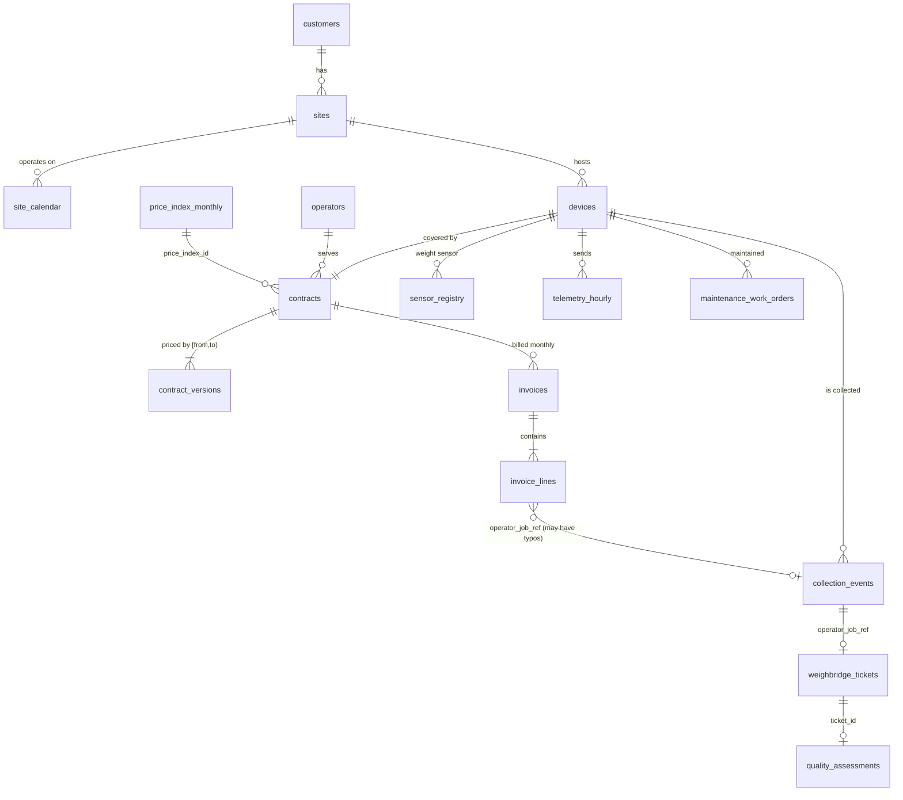

# Schema: tables, keys and joins

Package layout (both public packages share it):

```
public/
  reference/   customers, sites, site_calendar, devices, device_installations, sensor_registry,
               contracts, contract_versions, operators, regions, price_index_monthly,
               material_classes, quality_grade_rules          (facilities: operator data, private truth only)
  telemetry/   telemetry_hourly/month=YYYY-MM/part-*.parquet  (ingest log), telemetry_daily_summary
  operations/  collection_events, weighbridge_tickets, quality_assessments, maintenance_work_orders
  finance/     invoices, invoice_lines
  labels_dev/  anomaly_labels, reference_economics, reference_economics_monthly, reference_charge_lines,
               decision_truth, decision_outcomes, operator_scorecard (Task B2), operator_action_values (Task C2)
  benchmark/   decision_cases, task_ab_test_collections, task_b_test_invoice_lines, task_b2_scorecard_rows,
               operator_action_cases (Task C2), golden_cases_public.json
  metadata/    dataset_manifest.json, data_dictionary.json, scenario_catalog.csv
  csv/         (quickstart: all tables as CSV except the benchmark id lists; legacy_v0/ = shapes of the v0 starter pack)
  csv_samples/ (competition: CSV extracts for 25 devices)
private_evaluation/   NOT FOR DISTRIBUTION — truth/, labels_test/, holdout_full/, holdout_asof_<cutoff>/, benchmark/
```

## Entity-relationship diagram



## Primary keys and important joins

| Table | Primary key | Join |
|---|---|---|
| devices | device_id | `site_id → sites`, `contract_id → contracts`, `operator_id → operators` |
| contract_versions | contract_version_id | `contract_id` plus local service date in `[effective_from, effective_to)` |
| telemetry_hourly | **delivery_id** | `message_id` is **not** unique (duplicates). Deduplicate with `row_number() over (partition by message_id order by received_at)` (`sdk.telemetry_dedup`) |
| telemetry_daily_summary | (device_id, date) | local date |
| collection_events | collection_id | `operator_job_ref` is the only key the operator knows |
| weighbridge_tickets | ticket_id | `operator_job_ref`. Combined loads share `weighing_event_id` |
| quality_assessments | quality_assessment_id | `ticket_id` |
| invoices | invoice_id | `contract_id` + `billing_period` |
| invoice_lines | invoice_line_id | `operator_job_ref` (about 1.2 % typos; fall back to contract + service_date) |
| anomaly_labels | (entity_type, entity_id, label_family) | `entity_id` = collection_id / invoice_line_id / device-period key |
| reference_economics | collection_id | one row per collection event (all statuses); `observable_mass_source` says which mass a customer could see |
| reference_economics_monthly | (device_id, month) | group by site_id / material_stream / customer_id / contract_id for higher levels |
| decision_cases / decision_truth | case_id | `decision_outcomes` has one row per (case_id, action) |

## Time semantics

* All timestamps are UTC (`timestamp[ms, UTC]`). Business logic (calendars, contract validity, invoice months,
  label periods) uses **Europe/Helsinki local dates**.
* `measured_at` is when a value was true. `received_at` is when it became known. Use `received_at <
  decision_at` for leak-free features (`sdk.open_dataset(..., as_of=...)` does this).
* Weighbridge and quality rows become knowable at `published_at`, invoices at `issued_at`, prices at
  `published_on`.

The full column list with types, units, nullability and allowed values is in `DATA_DICTIONARY.md` and
`metadata/data_dictionary.json`.
