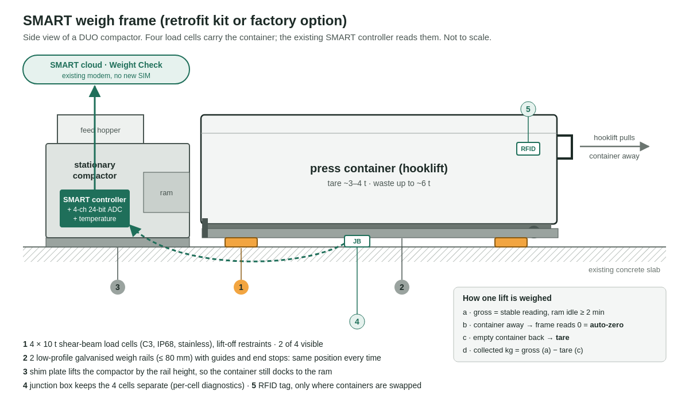

# 1 · Weighing concept: the SMART weigh frame

*Brief part 1, "Get the weight". No physical prototype was built. Costs and the accuracy budget are engineering estimates (hypothetical) to be checked by the validation plan below. All data is synthetic.*

## In one paragraph

Four load cells under the container's standing position, mounted in two low-profile weigh rails, read by a 4-channel weighing module in the existing SMART cabinet. Each lift is weighed as **gross before the lift − tare of the empty container that comes back**. Because the frame is empty every time the truck takes the container away, every lift also gives a **free zero check**. A rolling comparison with the operator's own weighbridge tickets checks the span. Design target: **σ = 1.5 % of the load** (15 kg floor). That keeps 97–98 % of 3 t loads within ±100 kg and lets the customer catch ~95 % of +10 % tonnage overbilling. Indicative cost: **€1,200 as a factory option, €3,400 as an installed retrofit.**

## Why this accuracy, and why a scale at all

What a given accuracy is worth, from `examples/weighing_accuracy_value.py` on 10,342 shared single-load tickets (competition data, *estimated*):

| scale σ (% of load) | 2.5–3.5 t loads within ±100 kg | median €/t error | detects +10 % overbilling | false alarms |
|---|---|---|---|---|
| 1.0 | 99.8 % | 0.85 % | 94.7 % | 0.8 % |
| **1.5 (our target)** | **98.3 %** | **1.10 %** | **95.0 %** | **1.0 %** |
| 1.75 (challenge minimum) | 94.8 % | 1.27 % | 94.6 % | 1.2 % |
| 2.5 | 82.1 % | 1.75 % | 92.5 % | 1.8 % |
| 5 | 53.2 % | 3.37 % | 46.7 % | 2.0 % |

Can software replace the scale? We tested it (`notes/weight_without_scale.py`, `notes/rotation_experiments.py`, leave-device-out against weighbridge truth):

| no-hardware method | median error per lift | per device-year |
|---|---|---|
| stream density × volume × fill (rule) | 14.1 % | – |
| ML on fill, press data, stream, sector | 8.6 % | – |
| density learned from the device's last 5 shared tickets | 7.0 % | – |
| rotating a weighing kit, 3 months per device | 6.9 % | 4.3 % (1-month kit) |

**Conclusion:** ~7 % is fine for a € per tonne trend (we use it as the free "value scan"), but invoice checks need σ ≤ ~2.5 %. Only a real scale gets there.

## Options compared

| option | cost per container | expected accuracy | independent of the operator? | verdict |
|---|---|---|---|---|
| **A · load-cell weigh frame** (chosen) | €1,200 factory / €3,400 retrofit | ~1.0 % budget, 1.5 % target | yes, owned by customer / Europress | the only option that reaches the invoice-check threshold |
| B · bolt-on strain gauges on frame or runners | ~€600 | 3–5 % (vendor specs) | yes | €/t reporting only; at 5 % overbilling detection falls to 47 % |
| C · hydraulic pressure on the truck's hooklift | per truck, not per container | ~1 % of gross vehicle weight, worse on the net load | no, operator's fleet | not an independent check |
| D · no hardware, fill and press data → weight model | ~€0 | 7 % per lift | yes | free value scan and €/t trend |

## Placement and installation

- **DUO (stationary compactor + hooklift container):** the frame sits under the container's standing position, not on the container. Containers are sometimes swapped, so the measurement must stay with the site. Two galvanised rails (≤ 80 mm high) carry two cells each; side guides and an end stop put the container in the same place every time.
- **Docking height:** the rails lift the container by up to 80 mm, so a shim plate (or plinth) lifts the compactor by the same amount and the container still lines up with the ram. On new sites the rails can be recessed into the slab instead.
- **COMBI (compactor and container one unit):** the same frame under the whole unit. The compactor's own mass is simply part of the tare.
- **Retrofit visit:** about 4 hours for two technicians, timed with a normal lift (the container is away anyway). Anchor and level the rails, set the shim, run the cable to the SMART cabinet, commission.
- **Factory option:** cells and rails integrated into the base frame at the factory, with the ADC on the controller board. No shim, no extra site visit.

## Indicative bill of materials (per container, € excl. VAT, small series of 100+, hypothetical)

| item | qty | retrofit € | factory option € |
|---|---|---|---|
| double-ended shear-beam load cell, 10 t, C3, IP68, stainless | 4 | 880 | 720 |
| mounting kit with lift-off restraint | 4 | 360 | 200 |
| low-profile galvanised weigh rails, guides, end stop (2 × ~5.5 m) | 1 set | 1,100 | 150 (extra steel in the base frame) |
| junction box, 4 separate channels, surge protection, 15 m armoured cable | 1 | 160 | 80 |
| 4-channel 24-bit weighing ADC + temperature sensor (in SMART cabinet) | 1 | 120 | 50 (on the controller board) |
| RFID container tag + reader (only where containers are swapped) | 1 | 90 | – |
| shim plate / plinth for the compactor | 1 | 150 | – |
| installation (2 technicians × 4 h) | | 450 | – |
| commissioning and calibration | | 150 | – (end-of-line test) |
| **total installed** | | **≈ 3,400** | **≈ 1,200** |

Four 10 t cells give 40 t of capacity for a gross load of at most ~10 t. The headroom covers the shock when a hooklift drags the container on.

**Is it affordable?** The median customer spends ~€880 per device-month on waste *(estimated)*. The factory option costs about 1.4 months of that spend, the retrofit about 3.9 months. After the €15/month subscription, the factory option pays back in **2.9 years at the median device** (50 % of devices within 3 years). The retrofit takes 8.2 years at the median and pays back within 5 years for only 29 % of devices (`notes/business_case_sensitivity.py`). Hence our rule: **weigh where it pays.** Factory option on every new compactor; retrofit only where the free value scan shows high value.

## Accuracy budget (engineering estimate, 3 t net load, container tare ~3.5 t)

| error source | mitigation | residual 1σ |
|---|---|---|
| cell non-linearity, hysteresis, repeatability (C3 ≈ 0.02 % of 40 t per reading, two readings per lift) | C3 cells, same load range before and after | ~11 kg |
| temperature change between the two readings (≤ 10 °C) | temperature-compensated cells, auto-zero at every lift | ~6 kg |
| container position, friction, side forces after roll-on | guides and end stop, lift-off restraints, stable-reading filter | ~25 kg |
| span calibration residual | water reference at commissioning, rolling weighbridge span check | ~12 kg (0.4 %) |
| ram pushing into the container | accept readings only with the ram idle ≥ 2 min | ~0 (procedure) |
| tare of a swapped container | RFID tare register, tare re-learned at every return | 0–30 kg (only if swapped) |
| **total, root-sum-square, same container** | | **≈ 31 kg ≈ 1.0 %** |

The 1.5 % design target leaves about 50 % margin for field effects.

**Not in the budget, flagged instead:**
- **Snow, ice and rainwater on the container roof.** In a Finnish winter this can be hundreds of kg. Flag it when mass rises with no compaction cycles, or while the site is closed.
- **Side waste.** It is never on the scale; it comes from the driver's report, and the app explains it.
- **Debris or ice under one corner.** The per-cell load share shifts; alert on it.
- **Liquid draining from mixed waste.** Small.

## Calibration

1. **Factory:** every cell has its own calibration certificate (mV/V). The ADC channels are calibrated at end of line.
2. **Commissioning, about 1 hour on site:**
   - zero with the frame empty;
   - corner check with the empty container (4-cell load share);
   - span with a **known water mass**: a 1,000-litre IBC filled through a calibrated flow meter (1,000 kg ± 0.5 %), placed in the container by forklift, one then two. A technician can bring this in a van; no 2 t test weights or crane are needed. Where there is no forklift, the span comes from the first 5 clean weighbridge tickets.
3. **In operation, automatic:**
   - **auto-zero** every time the container is away, with a drift alarm above 20 kg;
   - **rolling span check**: the median ratio of device to ticket over the last 10 clean single-load lifts (shared ticket, weighed tare, no side waste). Above 1 %, the app raises a "check the device scale" proposal for a human to approve. The demo already does this: `app/weight_rules.py → scale_check`.
4. **Yearly:** a verification check during the existing preventive maintenance visit.

**Legal metrology:** the frame is a *check* instrument, not a legal-for-trade scale. Billing stays on the operator's weighbridge. Using device weight as the billing basis would need conformity assessment under the EU directive on non-automatic weighing instruments (2014/31/EU). That is out of scope and part of a future hypothesis.

## How the data reaches SMART

The cells feed a 4-channel ADC that sits behind the SMART controller, which sends over the existing modem. The fields map one-to-one onto the dataset's own schema, so the dataset is effectively the integration contract:

| from the frame | dataset field |
|---|---|
| hourly stable mass + quality flag + sensor status | `telemetry_hourly.mass_kg`, `quality_flag`, `sensor_status` |
| mass before and after each lift, net | `collection_events.device_mass_kg_before / _after / device_estimated_collected_kg` |
| zero offset, per-cell share, temperature | new diagnostic fields, used for the scale-check proposal |

Details: `submission/2_SOFTWARE_DEMO.md`.

## Validation plan

| phase | where, how long | what we do | pass criteria |
|---|---|---|---|
| **0 · desk** (done) | synthetic data | accuracy-value curve (U10); no-scale models (7 %) | shows σ ≤ 1.75 % is needed and software alone is not enough |
| **1 · yard test** | Europress yard, 2 weeks, 1 frame, 1 DUO container | IBC water steps 0–1–2–3–4 t; 10 hooklift roll-off/roll-on cycles per step; off-centre loads; readings with the ram running vs idle | σ ≤ 1.0 % at 1–4 t; zero return ≤ 10 kg after roll-off; no reading accepted while the ram runs |
| **2 · field pilot** | 20 compactors, ≥ 2 streams, ≥ 2 operators, 3 months, sites that share tickets with weighed tare | compare device net with the weighbridge net on single-load lifts without side waste (≈ 240 lifts → 95 % coverage known to ±3 points) | ≥ 95 % of 2.5–3.5 t loads within ±100 kg; median error ≤ 1.5 %; uptime ≥ 98 %; zero drift ≤ 20 kg/month |
| **3 · winter** | same sites, December–February | the same, plus snow/ice flags and −25 °C | same thresholds; snow flag catches ≥ 90 % of no-compaction mass rises |
| **gate** | | | pass → factory option on new compactors; fail → strain-gauge variant for €/t reporting only |

The weighbridge reference itself has σ ≈ 12 kg plus 20 kg resolution (≈ 0.5 % on 3 t; `notes/precision_experiments.py`). So about 1 % is the best accuracy any field test against weighbridges can prove.

## Limitations

- The dataset cannot validate hardware. It "depicts a future scenario in which most devices have integrated weighing" (docs/ASSUMPTIONS_AND_LIMITATIONS.md).
- Accuracy figures for load cells and strain gauges are vendor and patent claims, not independent compactor tests.
- Costs are indicative, without supplier quotes. Installation time depends on the site (slab condition, access).
- Side waste and loose overflow will always be invisible to a container scale.
