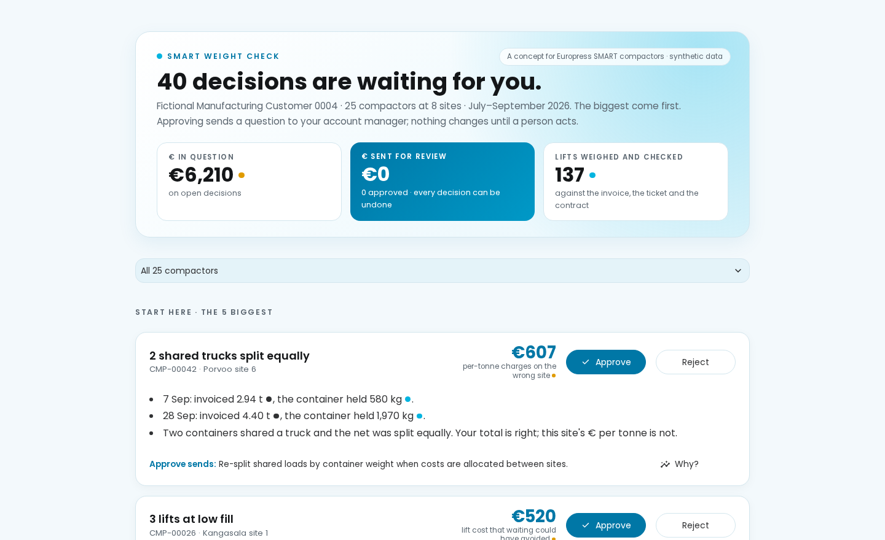
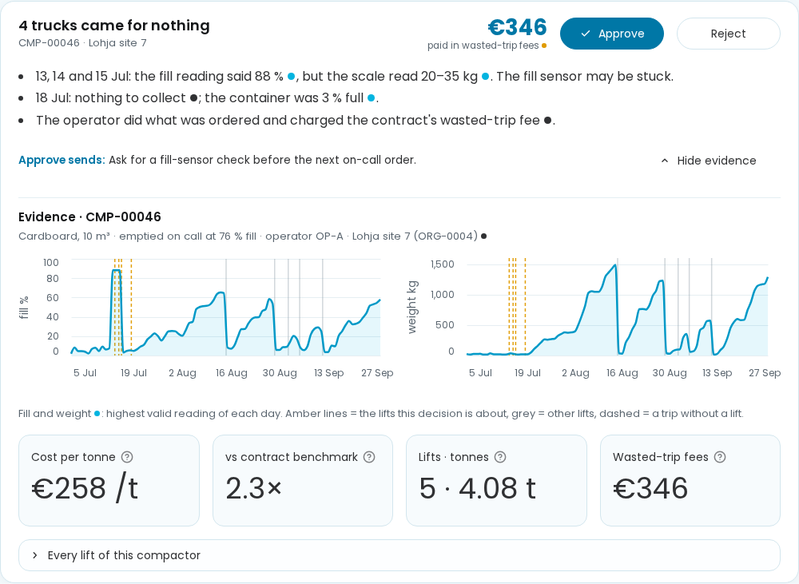
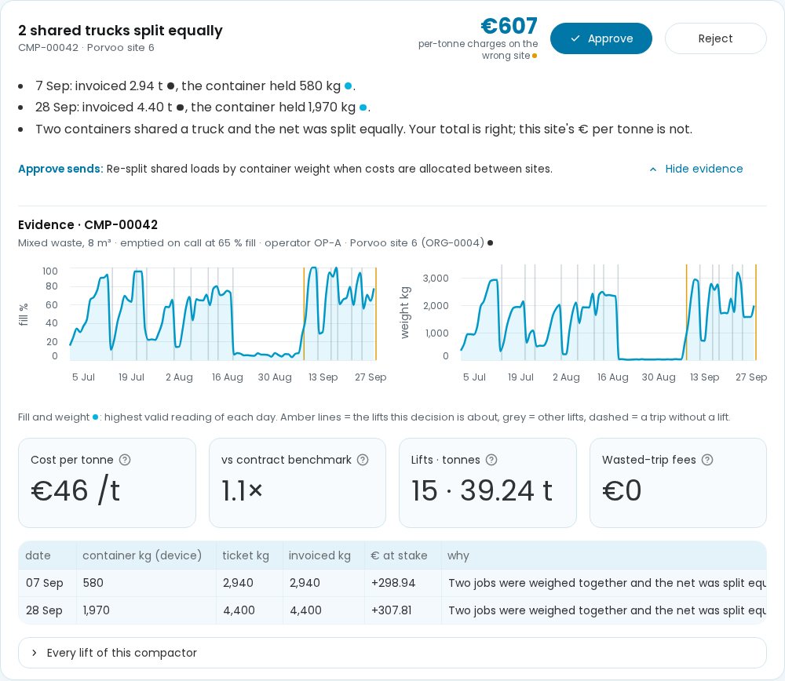
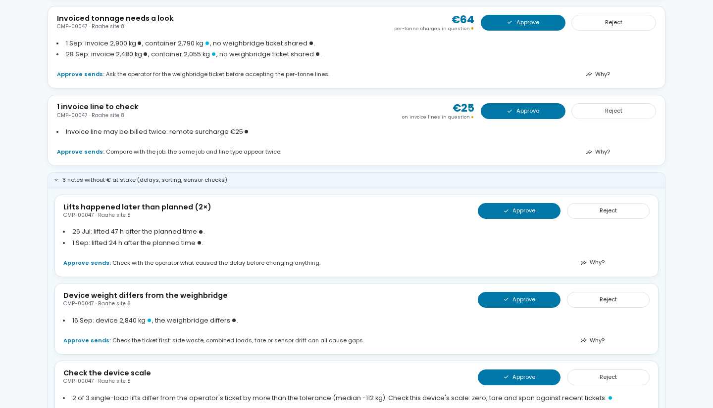
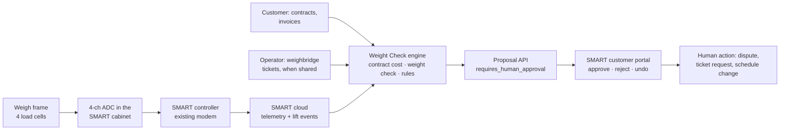

# 2 · Software demo: SMART Weight Check, with traceable economics and a SMART integration pathway

*Brief deliverable 2: a working software demo using synthetic weight data, with code and setup notes, traceable economics and a proposed SMART integration. All data is synthetic, not Europress data.*

## Run it (about 5 minutes)

Python 3.11 or newer, from the repository root:

```bash
python -m venv .venv
source .venv/bin/activate            # Windows: .venv\Scripts\activate
pip install -e ".[dev,app]"
streamlit run app/app.py
```

The app runs the contract calculator (Task A) and the rule-based flags (Task B) itself, in about two seconds on first load. The browser opens on the **decision inbox** of one fictional customer, ORG-0004: 25 compactors at 8 sites, July–September 2026. To show one compactor only, add `?device=` to the URL, for example `http://localhost:8501/?device=CMP-00042`.

## What the customer sees, top to bottom

| part | what it shows | evidence |
|---|---|---|
| Header | how many decisions are waiting, **€ in question** on open decisions, **€ sent for review** (it rises with every approval), lifts weighed and checked | estimated / simulated |
| **Start here · the 5 biggest** | one card per decision, ranked by € at stake: what was seen, on which compactor and site, the € and what it is, the findings with an evidence dot after every number, and what **Approve** sends. **Approve / Reject / Undo**; nothing executes | dot per number |
| **Why?** on a card | the evidence for that compactor: daily fill % and container weight with the decision's lifts in amber; cost per tonne, ratio to the contract benchmark, lifts and tonnes, wasted-trip fees; for weight questions, invoiced kg vs device kg vs the operator's ticket; every lift with its **weight source** (weighbridge ticket, invoice tonnage or device estimate). Unknown weight shows "unknown" and is never filled in | observed / simulated / estimated |
| More decisions · notes | the rest of the ranked decisions, then notes without € at stake (delays, sorting, scale checks) | estimated |

|  |  |
|---|---|
| The inbox: 40 decisions, €6,210 in question; the biggest is CMP-00042, two shared trucks split equally | **Why?** on CMP-00046: the fill reading stuck at 88 % in July while the scale read 20–35 kg; four trucks came for nothing (€346) |
|  |  |
| **Why?** on CMP-00042: invoiced 2.94 t and 4.40 t for loads of 580 kg and 1,970 kg; two containers shared a truck and the net was split equally | CMP-00047: two lifts invoiced without a shared ticket differ from the device weight, so Approve asks for the ticket. The scale-check note below points at the device, not the operator |

### How decisions are built and ranked

Findings of one kind on one compactor become one decision. The € is what the decision is *about*, never a promised saving: approving only sends a question.

| decision | from | € at stake |
|---|---|---|
| trucks came for nothing | wasted trips; "fill sensor may be stuck" when the reading said ≥ 70 % and the scale ≤ 100 kg on the order day | wasted-trip fees (contract calculation) |
| shared truck split equally | weight check: combined load, the site was charged for more than its container held | per-tonne charges on the wrong site; the customer's total is right |
| invoiced tonnage needs a look | weight check: invoice vs ticket, or no ticket and a difference beyond tolerance | difference × the invoice's own € per kg |
| invoice lines to check | Task B: duplicate line, surcharge, old tariff, unmatched line | amount of the lines in question |
| lifts at low fill | Task B early lifts plus the weight rules | only the empty part of each lift: lift cost × (1 − fill ÷ the on-call threshold), or × (1 − share of a typical full load) when the fill reading lied |
| cost per tonne above the benchmark | Task B, minus lifts already counted as early lifts, so no € is counted twice | cost above the benchmark × tonnes |
| notes | delays, contamination, device vs weighbridge, scale check | none |

## Demo path (about 75 seconds)

1. **The inbox opens**: 40 decisions are waiting, €6,210 in question *(estimated)*. The biggest is **CMP-00042**: lift COL-00042-0009 was invoiced 2.94 t *(observed)*; the container held 580 kg *(simulated)*. Two jobs shared a truck and the net was split equally. The other job is CMP-00034 at another site of the same customer, invoiced 2,960 kg for 5,315 kg. The customer total is right; each site's € per tonne is not. Approve sends: re-split shared loads by container weight.
2. **Why?** on **CMP-00046**, "4 trucks came for nothing": the fill line jumps to 88 % in mid-July and stays there while the weight line stays flat. The amber dashed lines are the wasted trips, €346 *(observed fees)*. € per tonne is 2.3× the contract benchmark *(estimated)*.
3. Click **Approve**: €346 moves to "€ sent for review" and the card turns into "Sent to your account manager". Click **Undo**.
4. **CMP-00047** (`?device=CMP-00047`): two lifts have no shared ticket and the invoice differs from the device weight (COL-00047-0009: +425 kg, €51 at stake). Approve sends: ask the operator for the ticket.

## How every euro is traceable

Each lift row can be followed back to its source rows:

```
collection_events.collection_id ─ operator_job_ref ─┬─ weighbridge_tickets (allocated_net_kg, loads_on_vehicle, allocation_method)
                                                     ├─ invoice_lines (line_type, quantity, unit_price_eur, amount_eur)
                                                     └─ contracts → contract_versions valid on the service date → expected lines (Task A)
```

- **Contract cost per lift** comes from the dataset package's contract calculator, which follows the dataset's economic model line by line. On the quickstart validation split it is **exact to the cent** in every cost category (74 events), and it never reports € per tonne where no weight is observable.
- **Weight check:** per lift, the maximum quantity on the per-tonne lines (processing, haul per tonne, material credit, rejection reprocessing) is compared with `device_estimated_collected_kg` and the ticket's `allocated_net_kg`.
  - Tolerance is max(100 kg, 3.3 %), the dataset's accuracy target.
  - € at stake = difference × the invoice's own € per kg; positive means the invoice works against the customer.
- **Results on all 50 quickstart devices:** 341 lifts with per-tonne lines.
  - 205 agree.
  - 29 are combined loads and 9 side waste: explained, nobody's fault.
  - 58 match the ticket but not the device. Those become one "check the scale" proposal per device (13 devices) instead of 58 billing questions.
  - 8 are in the customer's favour.
  - 28 have no device weight.
  - **4** are lift-level billing questions.

## Where the proposals come from, and how good they are

| source | what it flags | score |
|---|---|---|
| Task B rule baseline (dataset package) | unnecessary early lifts on schedules, delays, weight differences, billing discrepancies | quickstart validation macro F1 **0.856** |
| Weight rule "precautionary" | customer-ordered lifts at < 45 % fill just before a weekend or closed day | adds to the baseline: |
| Weight rule "false-high fill" | on-call lift that moved < 40 % of the device's typical full load, although the fill reading said full; **only the weight can see this** | early-lift F1 0.72 → **0.86** on competition validation (9 extra questions on justified lifts for 111 more real cases) |
| Weight check | invoice vs ticket mismatches, invoices without a ticket that differ from the device, combined-load re-splits, device scale checks | (no labels; explained in the app) |

**AI or rules?**
- We use transparent rules for every proposal. A customer or an operator must be able to read *why*, and the rubric asks for explainability.
- We use ML only where it clearly beats a rule: estimating weight without a scale. Gradient boosting reaches 8.6 % median error against 14.1 % for a density rule, leave-device-out. That estimate feeds the free "value scan", never a billing question.

## Proposed SMART integration pathway



**1 · Device → SMART.** The weighing module adds fields to the hourly message the controller already sends. The dataset's schema is the integration contract:

| message | fields (dataset name) |
|---|---|
| hourly telemetry | `mass_kg`, `quality_flag` (VALID, LOW_CONFIDENCE, NEGATIVE_READING, SUSPECT_SPIKE, SENSOR_FAULT), `sensor_status` |
| lift event | `device_mass_kg_before`, `device_mass_kg_after`, `device_estimated_collected_kg` |
| diagnostics (new) | zero offset when the container is away, per-cell load share, temperature |

**2 · Ingest.**
- Deduplicate and order buffered messages, as the dataset's `telemetry_dedup` view does: the quickstart data has 329 duplicate and 1,651 late messages.
- Build the daily summary.
- Recompute reconciliation statuses as of each decision. The dataset's own statuses are computed with hindsight, so they can see the future.

**3 · Commercial data.**
- **Contracts and invoices** come from the customer (upload, or an e-invoice feed with their consent).
- **Tickets** come from the operator, when shared. The Task C2 action `REQUEST_WEIGHBRIDGE_DATA` asks for them.

**4 · Engine.** Four steps, one module each, all in Python today (see the code map below):
- contract cost per lift;
- weight check and weight-based early-lift rules;
- anomaly rules;
- decisions per compactor, ranked by € at stake.

All run nightly per customer. The only state they keep is the customer's approve/reject history.

**5 · Proposal API.** One JSON object per proposal, in the shape of the dataset's recommendation API mock. Example for COL-00047-0009:

```json
{
  "schema": "smve.recommendation.v0 (illustrative mock)",
  "synthetic": true,
  "device_id": "CMP-00047", "collection_id": "COL-00047-0009",
  "proposal": {"action": "REQUEST_WEIGHBRIDGE_DATA", "requires_human_approval": true, "auto_execute": false},
  "evidence": {
    "observed": {"invoiced_kg": 2480, "ticket_shared": false},
    "simulated": {"device_kg": 2055},
    "estimated": {"difference_kg": 425, "eur_at_stake": 50.72},
    "hypothetical": {"tolerance": "max(100 kg, 3.3 %)"}
  },
  "rationale": "No weighbridge ticket was shared, and the invoice implies 425 kg more than the device weighed.",
  "check_before_acting": "Ask the operator for the weighbridge ticket before accepting the per-tonne lines.",
  "not_proven": ["The device scale may itself be off; see the device's scale-check history"]
}
```

**6 · Portal.** The Streamlit app is the prototype of a "Weight" tab in the SMART customer portal: one inbox per customer, ranked by € at stake. Approve sends the proposal to the account manager. Every decision is logged and can be undone.

**Rollout.**
1. Pilot customers on the existing SMART portal, with the weight check computed nightly in the cloud.
2. Firmware update for the controllers that get a weigh frame.
3. The proposal API opens to the customer's own purchasing or ERP system.

## Code map

| file | role |
|---|---|
| `app/app.py` | the Streamlit demo |
| `app/inbox.py` | turns findings into decisions per compactor, ranked by € at stake |
| `app/weight_rules.py` | weight check, device scale check, weight-based early-lift rules |
| `baselines/b1_economic_calculator.py`, `baselines/b2_rules_anomaly.py` | contract cost and rule baselines (from the dataset package) |
| `notes/premature_rule.py` | scores the weight-based early-lift rule against the labels |
| `notes/weight_without_scale.py`, `notes/rotation_experiments.py`, `notes/precision_experiments.py` | can software replace the scale? |
| `notes/business_case_sensitivity.py` | business-case sensitivity and hardware payback |
| `notes/explore.py`, `notes/scorecard.py`, `notes/punctuality.py` | exploration of the weight data, operator scorecard (Task B2), punctuality |
| `tests/test_inbox.py` | tests of the inbox and of approve / undo in the app |

**Tested:**
- The app runs for all 50 quickstart devices without errors (Streamlit test runner), and `tests/test_inbox.py` passes.
- `notes/premature_rule.py` reproduces the early-lift scores above.
- The dataset package's own test suite is unchanged: `python -m pytest`, about 5 minutes.

## What the demo does not prove

- It runs only on synthetic data. It has not seen a real invoice, a real weighbridge ticket or a real SMART message.
- The weight-check questions have no labels in the dataset, so their precision is not measured. Only the early-lift rules are scored.
- Approve records a decision in the demo; nothing is sent to anyone.
- The SMART integration pathway is a proposal. No firmware, ingest service or portal tab exists yet, and the proposal API is an illustrative mock.
