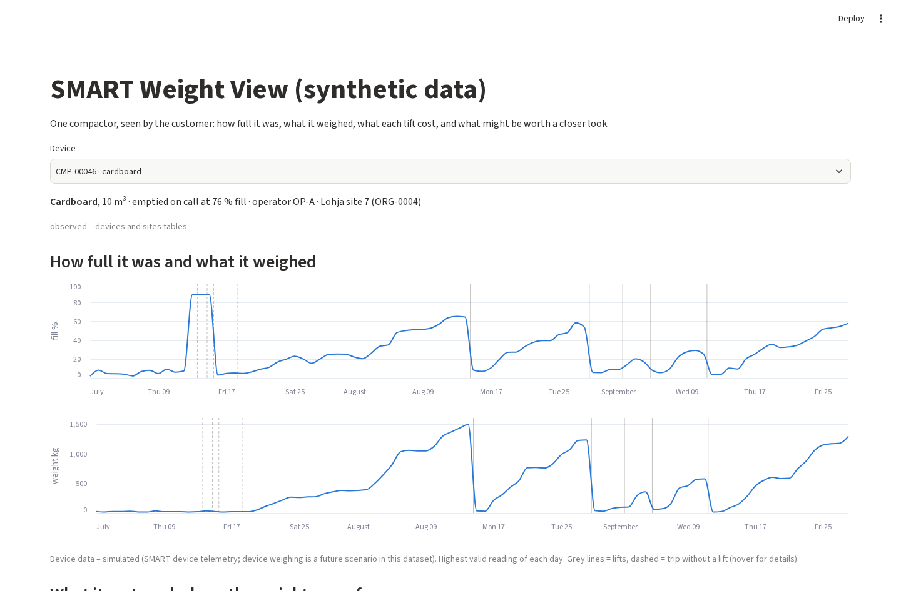
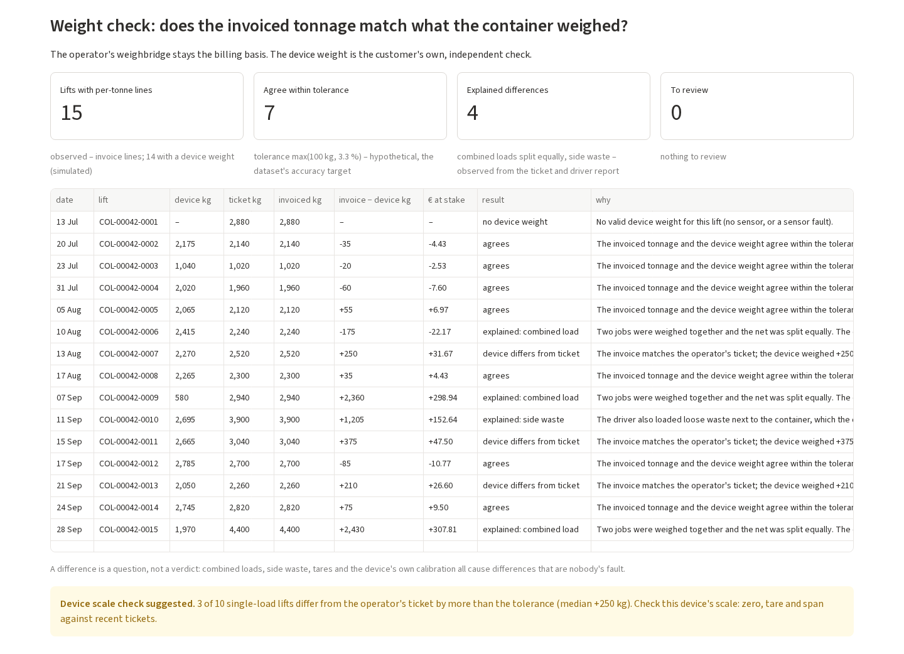
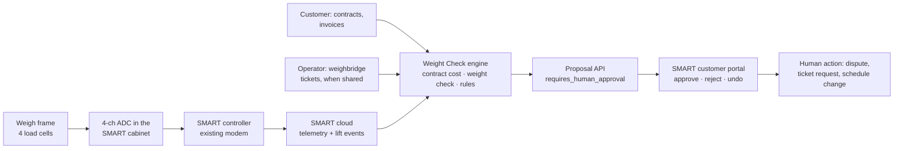

# 2 · Software demo: SMART Weight View, with traceable economics and a SMART integration pathway

*Brief deliverable 2: a working software demo using synthetic weight data, with code and setup notes, traceable economics and a proposed SMART integration. All data is synthetic, not Europress data.*

## Run it (about 5 minutes)

Python 3.11 or newer, from the repository root:

```bash
python -m venv .venv
source .venv/bin/activate            # Windows: .venv\Scripts\activate
pip install -e ".[dev,app]"
python baselines/b1_economic_calculator.py data/quickstart/public my_task_a.csv   # contract cost of every event (Task A)
python baselines/b2_rules_anomaly.py data/quickstart/public my_task_b.csv         # rule-based flags (Task B)
streamlit run app/app.py
```

The browser opens on compactor **CMP-00046**, the story device. To open another device directly, add `?device=` to the URL, for example `http://localhost:8501/?device=CMP-00042`. If the two CSV files are missing, the app says which command to run.

## What the customer sees, top to bottom

| section | what it shows | evidence |
|---|---|---|
| Device picker | material, size, collection policy, operator, site | observed |
| How full it was and what it weighed | daily fill % and container weight, each on its own axis; lifts as grey lines, trips without a lift dashed | simulated (device) |
| What it cost, and where the weight came from | € per tonne, ratio to the contract benchmark, tonnes, fees for trips without a lift; one row per lift with its **weight source** (weighbridge ticket, invoice tonnage or device estimate). Unknown weight shows "unknown" and is never filled in | estimated (contract calculation, hypothetical tariffs) |
| **Weight check** | for every lift with per-tonne invoice lines: invoiced kg vs device kg vs the operator's ticket, € at stake, a result and a plain reason | observed / simulated / estimated |
| Proposals | every flag as a card with what was seen, why, and what to check before acting. **Approve / Reject / Undo**; nothing executes | estimated |

|  |  |
|---|---|
| CMP-00046: fill reading stuck at 88 % in July while the scale reads ~0 kg (four wasted trips) | CMP-00042: weight check; one combined load split equally, re-split by device weight |

More screenshots: `notes/screenshots/` (full page, cost table, proposals with one approved, CMP-00047).

## Demo path (≈ 75 seconds)

1. **CMP-00046** (opens by default): the fill line jumps to 88 % in mid-July and stays there while the weight line stays flat. The four dashed lines are wasted trips, €346 *(observed)*. € per tonne is 2.3× the contract benchmark *(estimated)*.
2. **CMP-00042**: in the weight check, lift COL-00042-0009 was invoiced 2,940 kg; the device weighed 580 kg. The ticket shows two jobs on one truck, net split equally. The other job is CMP-00034 at another site of the same customer, invoiced 2,960 kg for 5,315 kg. The customer total is right; each site's € per tonne is not. Proposal: re-split by device weight.
3. **CMP-00047**: two lifts have no shared ticket and the invoice differs from the device weight (COL-00047-0009: +425 kg, €51 at stake). Proposal: ask the operator for the ticket.
4. Click **Approve** on a card, then **Undo**.

## How every euro is traceable

Each lift row can be followed back to its source rows:

```
collection_events.collection_id ─ operator_job_ref ─┬─ weighbridge_tickets (allocated_net_kg, loads_on_vehicle, allocation_method)
                                                     ├─ invoice_lines (line_type, quantity, unit_price_eur, amount_eur)
                                                     └─ contracts → contract_versions valid on the service date → expected lines (Task A)
```

- **Contract cost per lift** comes from `baselines/b1_economic_calculator.py`, which follows `docs/ECONOMIC_MODEL.md` line by line. On quickstart validation it is **exact to the cent** in every cost category (74 events), and it never reports € per tonne where no weight is observable (FINDINGS C01).
- **Weight check** (`app/weight_rules.py → weight_check`): per lift, the maximum quantity on the per-tonne lines (processing, haul per tonne, material credit, rejection reprocessing) is compared with `device_estimated_collected_kg` and the ticket's `allocated_net_kg`.
  - Tolerance is max(100 kg, 3.3 %), the dataset's accuracy target.
  - € at stake = difference × the invoice's own € per kg; positive means the invoice works against the customer.
- **Results on all 50 quickstart devices:** 341 lifts with per-tonne lines.
  - 205 agree.
  - 29 are combined loads and 9 side waste: explained, nobody's fault.
  - 58 match the ticket but not the device. Those become one "check the scale" proposal per device (13 devices) instead of 58 billing questions.
  - 8 are in the customer's favour.
  - 28 have no device weight.
  - **4** are lift-level billing questions.

## Where the proposals come from, and how good they are

| source | what it flags | score |
|---|---|---|
| Task B baseline (`baselines/b2_rules_anomaly.py`) | unnecessary early lifts on schedules, delays, weight differences, billing discrepancies | quickstart validation macro F1 **0.856** (FINDINGS C04) |
| Weight rule "precautionary" (`app/weight_rules.py`) | customer-ordered lifts at < 45 % fill just before a weekend or closed day | adds to the baseline: |
| Weight rule "false-high fill" | on-call lift that moved < 40 % of the device's typical full load, although the fill reading said full; **only the weight can see this** | early-lift F1 0.72 → **0.86** on competition validation (9 extra questions on justified lifts for 111 more real cases) |
| Weight check | invoice vs ticket mismatches, invoices without a ticket that differ from the device, combined-load re-splits, device scale checks | (no labels; explained in the app) |

**AI or rules?**
- We use transparent rules for every proposal. A customer or an operator must be able to read *why*, and the rubric asks for explainability.
- We use ML only where it clearly beats a rule: estimating weight without a scale. Gradient boosting reaches 8.6 % median error against 14.1 % for a density rule, leave-device-out (`notes/weight_without_scale.py`). That estimate feeds the free "value scan", never a billing question.

## Proposed SMART integration pathway



**1 · Device → SMART.** The weighing module adds fields to the hourly message the controller already sends. The dataset's schema is the integration contract:

| message | fields (dataset name) |
|---|---|
| hourly telemetry | `mass_kg`, `quality_flag` (VALID, LOW_CONFIDENCE, NEGATIVE_READING, SUSPECT_SPIKE, SENSOR_FAULT), `sensor_status` |
| lift event | `device_mass_kg_before`, `device_mass_kg_after`, `device_estimated_collected_kg` |
| diagnostics (new) | zero offset when the container is away, per-cell load share, temperature |

**2 · Ingest.**
- Deduplicate and order buffered messages, as in `telemetry_dedup`: 329 duplicates and 1,651 late messages in quickstart (FINDINGS U07).
- Build the daily summary.
- Recompute reconciliation statuses as of each decision. The dataset's naive statuses can see the future (`docs/BENCHMARK.md`).

**3 · Commercial data.**
- **Contracts and invoices** come from the customer (upload, or an e-invoice feed with their consent).
- **Tickets** come from the operator, when shared. The C2 action `REQUEST_WEIGHBRIDGE_DATA` asks for them.

**4 · Engine.** Three steps, one module each, all in Python today:
- contract cost: `baselines/b1_economic_calculator.py`;
- weight check and early-lift rules: `app/weight_rules.py`;
- anomaly rules: `baselines/b2_rules_anomaly.py`.

All run nightly per customer. The only state they keep is the customer's approve/reject history.

**5 · Proposal API.** One JSON object per proposal, in the shape of `examples/recommendation_api_mock.py`. Example for COL-00047-0009:

```json
{
  "schema": "smve.recommendation.v0 (illustrative mock)",
  "synthetic": true,
  "device_id": "CMP-00047", "collection_id": "COL-00047-0009",
  "proposal": {"action": "REQUEST_WEIGHBRIDGE_DATA", "requires_human_approval": true, "auto_execute": false},
  "evidence": {
    "observed": {"invoiced_kg": 2480, "ticket_shared": false},
    "simulated": {"device_kg": 2055},
    "estimated": {"difference_kg": 425, "eur_at_stake": 50.72},
    "hypothetical": {"tolerance": "max(100 kg, 3.3 %)"}
  },
  "rationale": "No weighbridge ticket was shared, and the invoice implies 425 kg more than the device weighed.",
  "check_before_acting": "Ask the operator for the weighbridge ticket before accepting the per-tonne lines.",
  "not_proven": ["The device scale may itself be off; see the device's scale-check history"]
}
```

**6 · Portal.** The Streamlit app is the prototype of a "Weight" tab in the SMART customer portal. Approve sends the proposal to the account manager. Every decision is logged and can be undone.

**Rollout.**
1. Pilot customers on the existing SMART portal, with the weight check computed nightly in the cloud.
2. Firmware update for the controllers that get a weigh frame.
3. The proposal API opens to the customer's own purchasing or ERP system.

## Code map

| file | role |
|---|---|
| `app/app.py` | the Streamlit demo |
| `app/weight_rules.py` | weight check, device scale check, weight-based early-lift rules |
| `baselines/b1_economic_calculator.py`, `baselines/b2_rules_anomaly.py` | contract cost and rule baselines (from the dataset package) |
| `notes/premature_rule.py` | scores the weight-based early-lift rule against the labels |
| `notes/weight_without_scale.py`, `notes/rotation_experiments.py`, `notes/precision_experiments.py` | can software replace the scale? |
| `notes/business_case_sensitivity.py` | business-case sensitivity and hardware payback |
| `notes/explore.py`, `notes/scorecard.py`, `notes/punctuality.py` | Epic 1–2 analysis |

**Checked:**
- The app runs for all 50 quickstart devices without errors (Streamlit test runner).
- `notes/premature_rule.py` reproduces the scores above.
- The repository's own test suite is unchanged: `python -m pytest`, about 5 minutes.
